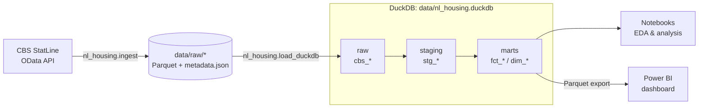

# NL Housing Affordability

[](https://github.com/dimaash03/nl-housing-affordability/actions/workflows/ci.yml)

> **Status (2026-11-27): data model complete, analysis and dashboard in progress.**
> Done: ingestion from CBS, cleaning, harmonisation to the 2026 municipalities, and the star schema
> (`fct_affordability`, `fct_group_affordability`, three dimensions) with 21 automated data checks.
> Next: short analysis notebook with findings, then the Power BI dashboard. Details: [docs/PROJECT_STATUS.md](docs/PROJECT_STATUS.md).

| Stage | State |
|---|---|
| 1. Scoping, data sourcing, metric definitions | done |
| 2. Ingestion & staging (CBS OData → DuckDB) | done |
| 3. Marts: star schema + group aggregates | done |
| 4. Analysis notebook (findings, sensitivity checks) | next |
| 5. Power BI dashboard | next |
| 6. Write-up (insights, limitations) | after 4–5 |

How affordable is buying a home in the Netherlands, and how has that changed over the last decade?
This project relates average house prices to household income for every Dutch municipality (*gemeente*)
over roughly the last 10+ years, and compares the four big Randstad cities (Amsterdam, Rotterdam,
Den Haag, Utrecht) with the rest of the country. All data comes from official CBS open data; the
pipeline is fully reproducible from a single `make` command, and the results are presented in a
Power BI dashboard built on a star schema.

## Business questions

1. How has the **price-to-income ratio** (average sale price ÷ median disposable household income) developed per municipality and province from 2011 to 2025?
2. Which municipalities are the **least and most affordable**, and how has their ranking changed?
3. Where did **prices grow faster than incomes**, and has the gap between the **G4** (Amsterdam, Rotterdam, Den Haag, Utrecht) and the **rest of the Netherlands** widened or narrowed?
4. What does buying the average home mean for a median household: **years of saving for the upfront costs**, and the **monthly payment** under different mortgage rates?

Robustness checks: owner-occupier income instead of all households, a quality-adjusted price index for the G4 and provinces,
and 2024 (final) instead of 2025 (preliminary). Metric definitions: [docs/DATA_DICTIONARY.md](docs/DATA_DICTIONARY.md);
the reasoning behind each choice: [docs/DECISIONS_LOG.md](docs/DECISIONS_LOG.md).

## Data sources

- **CBS StatLine** (Statistics Netherlands) via the public **OData API** (`opendata.cbs.nl`), licensed CC BY 4.0.
- The tables used, their columns and caveats are documented in [docs/DATA_DICTIONARY.md](docs/DATA_DICTIONARY.md);
  the table research is in `docs/cbs_tables_research.md`, and the list the pipeline downloads is `config/cbs_tables.yaml`.

## Tech stack

| Layer | Tool |
|---|---|
| Ingestion | Python 3.11+, `requests`, `pandas`, `pyarrow` (raw data stored as Parquet) |
| Storage & transformation | DuckDB (schemas `raw` → `staging` → `marts`), SQL |
| Analysis | Jupyter, pandas, matplotlib, plotly |
| Dashboard | Power BI Desktop (star schema) |
| Quality | pytest (offline unit tests), SQL data tests (`make check`), ruff (lint + format), GitHub Actions CI |

## Architecture



## Data model (built)

| Table | Grain | Rows | Content |
|---|---|---:|---|
| `fct_affordability` | municipality (2026 division) × year 2011–2025 | 5 130 | average sale price, median income (all households and owner-occupiers), price-to-income ratio (PTI), real values (2025 euro), growth since 2011, PTI rank, quality flags |
| `fct_group_affordability` | group × year | 270 | the same metrics for NL, the 12 provinces, **G4 vs Rest of NL** and **G4 / Rest of Randstad provinces / Rest of NL** |
| `dim_municipality` | municipality | 342 | name, province, COROP, G4 flag, region groups, urbanity |
| `dim_province` | province | 12 | name, Randstad flag |
| `dim_year` | year | 15 | label (`2025*` = preliminary), data-availability flags, latest (final) year |

Group figures are never an average of municipal ratios: a group PTI is the group price divided by the group income
(D-016). How each group value is built, and which ones are approximations:

| Group | Price | Median income |
|---|---|---|
| NL, provinces | published by CBS | published by CBS |
| G4 | transaction-weighted mean of the four cities | household-weighted mean of municipal medians — **approximation** |
| Rest of NL, Rest of Randstad provinces | exact residual (NL or Randstad provinces minus G4, by transaction counts) | household-weighted mean of municipal medians — **approximation** |

The approximated rows carry `is_income_approximated = true` (and `income_method`); the method is validated at country
level, where it stays within +0.5 … +1.0 % of the official NL median in every year (`assert_income_weighted_median_vs_nl.sql`).
Definitions: [docs/DATA_DICTIONARY.md](docs/DATA_DICTIONARY.md); model notes: [sql/marts/README.md](sql/marts/README.md).

## Repository structure

```
nl-housing-affordability/
├── .github/workflows/ # CI: lint + unit tests (Python 3.11 and 3.13, geo extras); manual full pipeline run
├── config/            # cbs_tables.yaml (tables to ingest) + an example file
├── data/
│   ├── raw/           # CBS downloads, one folder per table (gitignored)
│   └── processed/     # exported marts for Power BI (gitignored)
├── docs/              # data dictionary, decisions log, project status
├── notebooks/         # EDA and analysis
├── powerbi/           # .pbix file and dashboard notes
├── sql/
│   ├── models.yaml    # execution order of the SQL models
│   ├── staging/       # stg_* models: clean & rename raw CBS tables
│   ├── marts/         # fct_* / dim_* models: the star schema
│   └── tests/         # data tests: each query returns the rows that violate an expectation
├── src/nl_housing/    # Python package: config, ingest, load_duckdb, harmonise, transform, check, export, geo
├── tests/             # offline unit tests (network is mocked)
├── Makefile
├── requirements.txt      # dependency lower bounds
├── requirements.lock     # exact versions of the last tested environment
├── requirements-geo.txt  # optional geo extras (lower bounds)
└── requirements-geo.lock # exact versions of the geo extras
```

## How to run

### Quick start: reproduce everything from a fresh clone

Requirements: Python **3.11+** (DuckDB 2.x, D-032), `make`, internet access to `opendata.cbs.nl`
(no API key). Developed on macOS / Apple Silicon; CI runs on Linux with Python 3.11 and 3.13.

```bash
git clone https://github.com/dimaash03/nl-housing-affordability.git
cd nl-housing-affordability
make setup        # or: make setup-locked (exact versions, Python >= 3.12)
make reproduce    # = ingest -> load -> transform -> check -> export
make test         # offline unit tests
```

The steps depend on each other in this order; `make check` needs the tables that `make transform` builds
(run earlier, it stops with "run `make transform` before `make check`").

| Step | Input | Output | Expected result (2026-11-27, CBS data as published that day) |
|---|---|---|---|
| `make ingest` | internet | `data/raw/<table>/` for 7 CBS tables (~14 MB) | `failed=[]`; a few minutes (86380NED has ~325 000 rows) |
| `make load` | `data/raw/`, `data/reference/municipality_mapping_2026.csv` (committed) | schemas `raw`, `reference` in `data/nl_housing.duckdb` | `Loaded 38 table(s)`, `Loaded 456 rows into reference.municipality_mapping_2026` |
| `make transform` | `raw`, `reference`, `config/cbs_tables.yaml` (`project:`) | schemas `staging`, `marts` | `Built 12 model(s)`; `fct_affordability` 5 130 rows, `fct_group_affordability` 270 |
| `make check` | built database | — | `21 check(s): 21 passed, 0 failed` |
| `make export` | `marts` | `data/processed/marts/*.parquet` (5 files, Power BI input) | 5 files |
| `make test` | — (no network) | — | `174 passed`; with the geo extras installed, nothing skipped |

CBS revises figures, so a later download can move numbers slightly; the checks are written as tolerances and
rules, not as frozen values. If a check fails after a fresh download, its output lists the offending rows.
In a sandbox that blocks local sockets, run `make test PYTEST_ARGS='-m "not loopback"'` (skips 7 retry tests that
start a local HTTP server); CI runs the full suite.

### All targets

```bash
make setup       # create .venv, install requirements.txt and the nl_housing package
make ingest      # download all tables in config/cbs_tables.yaml to data/raw/ (FORCE=1 to refresh)
make load        # load data/raw/ into data/nl_housing.duckdb, schema `raw`
make transform   # build the SQL models into schemas `staging` / `marts` (order: sql/models.yaml)
make check       # run the SQL data tests in sql/tests/ against the database
make export      # write the marts tables to data/processed/marts/*.parquet (Power BI input)
make build       # load + transform + check + export (data already downloaded)
make reproduce   # ingest + build
make test        # run unit tests (no network needed)
make lint        # ruff lint + format check (`make format` fixes)

# Optional: municipality boundaries for the map (PDOK, D-014)
make setup-geo   # install shapely / pyproj / topojson (requirements-geo.lock)
make geo         # download + simplify into data/reference/municipalities_2026.* (FORCE=1 to re-download)
```

Without `make`:

```bash
python3 -m venv .venv && source .venv/bin/activate
pip install -r requirements.txt && pip install -e .
python -m nl_housing.ingest [--table 83625NED] [--force]
python -m nl_housing.load_duckdb
python -m nl_housing.transform
python -m nl_housing.check
pytest
```

**Reproducible environment.** `requirements.txt` holds lower bounds (what the code needs);
`requirements.lock` pins the exact versions the pipeline was last run and tested with
(`make setup-locked` installs it; `make lock` regenerates it from `.venv`). The lock file was generated on
Python 3.13 / Linux and some pins (e.g. numpy) need Python 3.12 or newer; on Python 3.11 use `make setup`.

**Analysis parameters** (years 2011–2025, base year, G4 codes, Randstad provinces, low-reliability threshold) are set
once in `config/cbs_tables.yaml` under `project:`; `make transform` writes them to `reference.project_settings`, which
every model reads (D-031).

Ingestion is idempotent: tables that are already downloaded are skipped unless `--force` is used.
Every table folder contains a `metadata.json` with the download timestamp (UTC), row count and source URL.
Requests to CBS are retried on HTTP 429/5xx and connection errors with exponential backoff (honouring `Retry-After`).
`make transform` rebuilds every model with `CREATE OR REPLACE TABLE` inside one transaction, so it can be re-run
safely and a failing model leaves the previous tables untouched.

## Tech choices

- **DuckDB instead of PostgreSQL** — zero setup on a Mac (no server, a single file), fast analytical SQL,
  reads Parquet natively. Power BI (running in a Windows VM) reads the marts exported as Parquet, so no database
  server or driver is required on the Windows side.
- **Raw OData via `requests` instead of `cbsodata.get_data`** — `cbsodata` replaces dimension codes
  (e.g. `GM0363`) with labels (`Amsterdam`). Keeping the stable codes in the fact data and the labels in separate
  dimension tables gives reliable joins and maps directly onto the star schema. `cbsodata` remains available for
  quick exploration in notebooks.
- **Parquet for raw files** — typed, compact, and keeps the raw layer an exact, re-loadable copy of CBS.
- **Layered SQL (raw → staging → marts)** — raw is never edited; all cleaning is explicit and reviewable in SQL.

## Key insights

Written after the analysis notebook (stage 4); no conclusions are published before they are checked.
The first computed outputs of the group table (`marts.fct_group_affordability`; * = preliminary income):

| Group | PTI 2011 | PTI 2024 | PTI 2025* | Price growth minus income growth 2011–2024 (pp) |
|---|---:|---:|---:|---:|
| Netherlands | 7.48 | 9.24 | 9.46 | 35.8 |
| G4 | 9.41 | 12.12 | 12.01 | 46.6 |
| Rest of Randstad provinces | 7.58 | 9.22 | 9.46 | 32.7 |
| Rest of NL | 6.86 | 8.39 | 8.65 | 33.5 |

PTI = average sale price of existing homes ÷ median disposable household income. It mixes a mean with a median, so
compare levels between groups and changes over time, not against a "rule-of-thumb" threshold (see Limitations).

## Dashboard

Planned (stage 5): Power BI report on the exported Parquet files — national KPIs, municipality map, G4 vs regions,
municipality detail. Screenshots and a walkthrough will be added here.

## Limitations

Known from the data design (each one has a decision in [docs/DECISIONS_LOG.md](docs/DECISIONS_LOG.md));
the analysis notebook will add sensitivity checks for them.

- **PTI mixes a mean price with a median income** (D-004): CBS publishes no median sale price per municipality.
  Ratios are best read relative to each other and over time.
- **Price is not quality-adjusted:** the average reflects what was sold that year (size, type, location).
- **Income of all households**, renters included (D-003); owner-occupier income is the planned sensitivity.
- **Nominal values** in the PTI (price and income share the deflator); real values in 2025 euro are available for growth.
- **Municipal reorganisations:** prices of merged municipalities are rebuilt on the 2026 map with owner-occupied-stock
  weights (D-007); 311 of 5 130 rows are harmonised. Group prices use each year's boundaries, so Weesp counts
  outside the G4 before 2022.
- **2025 income is preliminary** (CBS status "Voorlopig"); headline figures are re-checked on 2024.
- **Small municipalities** (< 5 000 households, 19 in 2024) are kept but not ranked; three have no 2025 income.
- **Group incomes are approximations** (household-weighted mean of municipal medians), see the table above.

## License & attribution

Data: © CBS (Statistics Netherlands), [CC BY 4.0](https://creativecommons.org/licenses/by/4.0/).
