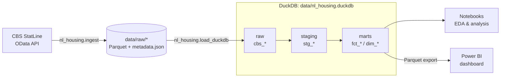

# NL Housing Affordability

> **Status: Work in progress** — stage 2 (ingestion & staging). See [docs/PROJECT_STATUS.md](docs/PROJECT_STATUS.md).

How affordable is buying a home in the Netherlands, and how has that changed over the last decade?
This project relates average house prices to household income for every Dutch municipality (*gemeente*)
over roughly the last 10+ years, and compares the four big Randstad cities (Amsterdam, Rotterdam,
Den Haag, Utrecht) with the rest of the country. All data comes from official CBS open data; the
pipeline is fully reproducible from a single `make` command, and the results are presented in a
Power BI dashboard built on a star schema.

## Business questions

1. How has the **price-to-income ratio** (average sale price ÷ median disposable household income) developed per municipality and province from 2011 to 2025?
2. Which municipalities are the **least and most affordable**, and how has their ranking changed?
3. Where did **prices grow faster than incomes**, and has the gap between the **G4** (Amsterdam, Rotterdam, Den Haag, Utrecht) and the **rest of the Netherlands** widened or narrowed?
4. What does buying the average home mean for a median household: **years of saving for the upfront costs**, and the **monthly payment** under different mortgage rates?

Robustness checks: owner-occupier income instead of all households, a quality-adjusted price index for the G4 and provinces,
and 2024 (final) instead of 2025 (preliminary). Metric definitions: [docs/DATA_DICTIONARY.md](docs/DATA_DICTIONARY.md);
the reasoning behind each choice: [docs/DECISIONS_LOG.md](docs/DECISIONS_LOG.md).

## Data sources

- **CBS StatLine** (Statistics Netherlands) via the public **OData API** (`opendata.cbs.nl`), licensed CC BY 4.0.
- The tables used, their columns and caveats are documented in [docs/DATA_DICTIONARY.md](docs/DATA_DICTIONARY.md);
  the table research is in `docs/cbs_tables_research.md`, and the list the pipeline downloads is `config/cbs_tables.yaml`.

## Tech stack

| Layer | Tool |
|---|---|
| Ingestion | Python 3.10+, `requests`, `pandas`, `pyarrow` (raw data stored as Parquet) |
| Storage & transformation | DuckDB (schemas `raw` → `staging` → `marts`), SQL |
| Analysis | Jupyter, pandas, matplotlib, plotly |
| Dashboard | Power BI Desktop (star schema) |
| Quality | pytest (offline unit tests) |

## Architecture



Planned star schema for Power BI: `fct_affordability` (grain: municipality × year) with
`dim_municipality`, `dim_year` and `dim_province`.

## Repository structure

```
nl-housing-affordability/
├── config/            # cbs_tables.yaml (tables to ingest) + an example file
├── data/
│   ├── raw/           # CBS downloads, one folder per table (gitignored)
│   └── processed/     # exported marts for Power BI (gitignored)
├── docs/              # data dictionary, decisions log, project status
├── notebooks/         # EDA and analysis
├── powerbi/           # .pbix file and dashboard notes
├── sql/
│   ├── staging/       # stg_* models: clean & rename raw CBS tables
│   └── marts/         # fct_* / dim_* models: the star schema
├── src/nl_housing/    # Python package: config, ingest, load_duckdb
├── tests/             # offline unit tests (network is mocked)
├── Makefile
└── requirements.txt
```

## How to run

Requires Python 3.10+ (developed on macOS / Apple Silicon).

```bash
make setup     # create .venv, install requirements and the nl_housing package
make ingest    # download all tables in config/cbs_tables.yaml to data/raw/ (FORCE=1 to refresh)
make load      # load data/raw/ into data/nl_housing.duckdb, schema `raw`
make test      # run unit tests (no network needed)
```

Without `make`:

```bash
python3 -m venv .venv && source .venv/bin/activate
pip install -r requirements.txt && pip install -e .
python -m nl_housing.ingest [--table 83625NED] [--force]
python -m nl_housing.load_duckdb
pytest
```

Ingestion is idempotent: tables that are already downloaded are skipped unless `--force` is used.
Every table folder contains a `metadata.json` with the download timestamp (UTC), row count and source URL.

## Tech choices

- **DuckDB instead of PostgreSQL** — zero setup on a Mac (no server, a single file), fast analytical SQL,
  reads Parquet natively. Power BI (running in a Windows VM) reads the marts exported as Parquet, so no database
  server or driver is required on the Windows side.
- **Raw OData via `requests` instead of `cbsodata.get_data`** — `cbsodata` replaces dimension codes
  (e.g. `GM0363`) with labels (`Amsterdam`). Keeping the stable codes in the fact data and the labels in separate
  dimension tables gives reliable joins and maps directly onto the star schema. `cbsodata` remains available for
  quick exploration in notebooks.
- **Parquet for raw files** — typed, compact, and keeps the raw layer an exact, re-loadable copy of CBS.
- **Layered SQL (raw → staging → marts)** — raw is never edited; all cleaning is explicit and reviewable in SQL.

## Key insights

TODO — will be added once the analysis is done. No results are reported before they are computed from the data.

## Dashboard

TODO — screenshots and a short walkthrough of the Power BI report.

## Limitations

TODO — e.g. definitions of income and house price used, municipal boundary changes (*gemeentelijke herindelingen*),
data revisions and provisional figures.

## License & attribution

Data: © CBS (Statistics Netherlands), [CC BY 4.0](https://creativecommons.org/licenses/by/4.0/).
